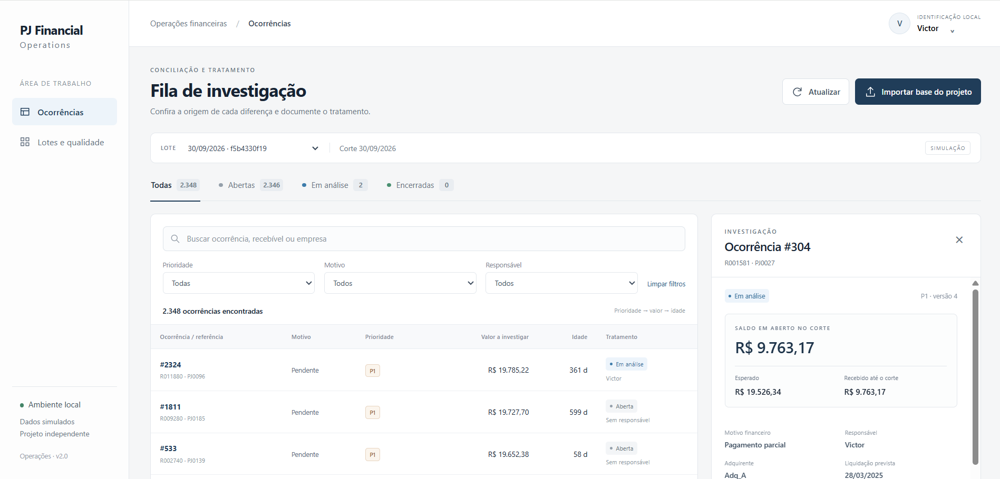
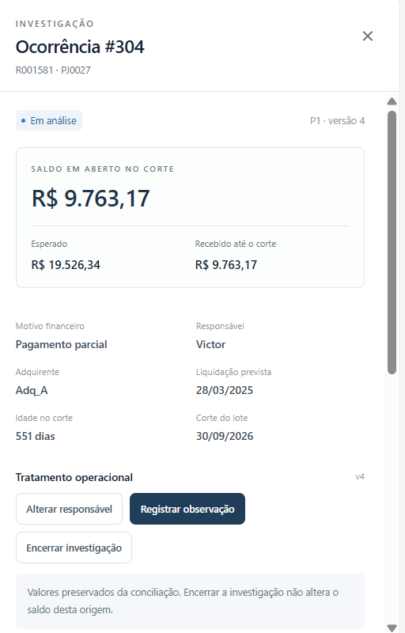
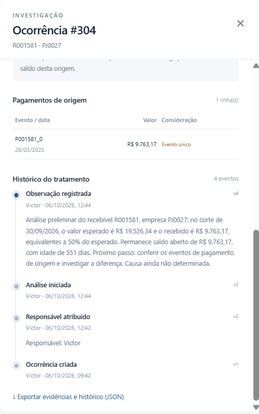

# PJ Financial Operations

**Conciliação de recebíveis PJ, investigação de divergências e histórico de tratamento.**


[](#validação)
[](#base-simulada-e-qualidade)
[](#como-executar)

[Aplicação](#aplicação-em-operação) · [Caso demonstrado](#caso-demonstrado) · [Controles](#controles-implementados) · [Tecnologias](#tecnologias) · [Executar](#como-executar) · [Testes](#validação)

## Em 30 segundos

Uma aplicação para transformar diferenças de liquidação em casos que um analista pode **conferir, priorizar e documentar**. O projeto reúne conciliação em Python e SQL, uma fila operacional no navegador e evidências preservadas por lote.

| Base de demonstração | Volume analisado | Fila de investigação |
|---|---|---|
| **300 empresas fictícias** | **12.000 recebíveis** | **2.348 ocorrências** |

O caso apresentado abaixo acompanha um recebível com **R$ 9.763,17 ainda em aberto**: pagamento de origem identificado, responsável atribuído e análise registrada, com a causa ainda em investigação.

*Projeto independente de portfólio. Dados integralmente sintéticos, sem vínculo com o Banco Sofisa ou integração com sistemas financeiros reais.*

## Aplicação em operação



A fila organiza os casos por prioridade, valor a investigar e idade. Os filtros permitem localizar ocorrências por situação, motivo e responsável. Cada detalhe preserva a referência ao recebível e ao corte do lote.

## Problema de negócio

Uma diferença entre o valor esperado e o recebido precisa ser investigada antes de ser tratada como perda, inadimplência ou erro de um parceiro. O analista precisa conhecer a origem do valor, evitar contagens duplicadas e registrar o que verificou.

O projeto implementa esse fluxo:

1. Validar as fontes e conciliar pagamentos únicos até uma data de corte.
2. Separar pagamentos parciais, pendências, excessos, atrasos e pagamentos sem vínculo.
3. Criar uma fila com critérios explícitos de priorização.
4. Atribuir um responsável, investigar e registrar observações.
5. Encerrar ou reabrir a investigação com justificativa, preservando os valores financeiros de origem.

## Caso demonstrado

### Um pagamento de 50% do esperado

Na ocorrência **#304**, recebível **R001581**, empresa fictícia **PJ0027**, o pagamento observado corresponde a 50% do valor esperado.

| Conferência | Evidência no corte de 30/09/2026 |
|---|---|
| Valor esperado | R$ 19.526,34 |
| Pagamento identificado | R$ 9.763,17 |
| Saldo em aberto | R$ 9.763,17 |
| Data prevista e data do pagamento | 28/03/2025 |
| Evento de pagamento | P001581_0 — evento único |
| Idade do saldo no corte | 551 dias |
| Tratamento demonstrado | Em análise, responsável Victor, versão 4 |

O pagamento identificado ocorreu na data prevista, mas não liquidou integralmente a obrigação. A prioridade **P1** decorre da idade do saldo, que supera o limite didático de 180 dias.

O histórico contém criação, atribuição de responsável, início de análise e observação. A nota registra os valores conferidos e a necessidade de investigar a diferença. **A causa permanece não determinada e a investigação não foi encerrada.**

| Resumo financeiro | Pagamento de origem e histórico |
|---|---|
|  |  |

As capturas representam uma sessão local de demonstração. O banco com esses tratamentos não é distribuído no repositório; uma instalação nova começa com as ocorrências abertas.

## Controles implementados

A investigação se apoia em três controles centrais: **conferência das fontes**, **preservação das evidências** e **registro consistente das ações**. Uma ação com versão antiga é rejeitada, e a mesma importação não recria os casos.

<details>
<summary><strong>Ver os 11 controles implementados e o comportamento de cada um</strong></summary>

| Controle | Comportamento |
|---|---|
| Valores em centavos inteiros | Evita cálculos monetários com ponto flutuante na conciliação |
| Agregação antes da comparação | Evita multiplicar o valor esperado quando há vários pagamentos para um recebível |
| Deduplicação de eventos | Remove repetições técnicas; mesmo ID com conteúdo divergente bloqueia o processamento |
| Corte temporal | Exclui pagamentos posteriores ao corte e separa recebíveis ainda a vencer |
| Validação da importação | Recalcula a conciliação e confere o CSV processado e os totais antes de gravar o lote |
| Reimportação idempotente | Os mesmos arquivos e regras reutilizam o lote e preservam os tratamentos |
| Identificação das fontes | Manifesto com hashes SHA-256 dos arquivos usados na importação |
| Concorrência por versão | Rejeita ações com versão antiga; a interface mantém a observação digitada para revisão |
| Transações | Grava a mudança de estado e seu evento juntos; falhas revertem a operação |
| Preservação das evidências | Regras e triggers bloqueiam atualização e exclusão de evidências e eventos pelas operações normais |
| Exportação | JSON com evidências, histórico, versões, corte e manifesto do lote |

</details>

**Encerrar uma investigação não altera o saldo da conciliação nem comprova quitação.** Uma mudança financeira exige novas fontes e uma nova avaliação.

## Base simulada e qualidade

A importação valida IDs, vínculos, datas e valores antes de criar o lote. Duplicatas, registros fora do corte e pagamentos sem recebível são identificados separadamente.

<details>
<summary><strong>Conferir as quantidades, o corte e a composição das ocorrências</strong></summary>

A base usa geração determinística com seed `42` e corte em **30/09/2026**. As quantidades abaixo podem ser conferidas em [reports/validacao.json](reports/validacao.json) e na [especificação do motor](docs/06_operacoes_especificacao.md).

| Item | Quantidade |
|---|---:|
| Empresas fictícias | 300 |
| Recebíveis | 12.000 |
| Recebíveis elegíveis no corte | 11.727 |
| Ocorrências para investigação | 2.348 |
| Duplicatas técnicas removidas | 586 |
| Linhas de pagamento posteriores ao corte | 293 |
| Pagamentos sem recebível conhecido | 1 |

As 2.348 ocorrências incluem 585 pagamentos parciais, 591 pendências, 585 excessos, 586 liquidações com atraso e um pagamento sem recebível. Essa quantidade **não representa perda financeira**. Recebíveis conciliados no prazo e ainda a vencer não entram na fila de divergências.

</details>

## Tecnologias

| Tecnologia | Aplicação no projeto |
|---|---|
| **Python** | Conciliação, importação, regras de tratamento, servidor HTTP e testes `unittest` |
| **SQL / SQLite** | Consultas analíticas, banco local, transações, integridade referencial e triggers |
| **JavaScript** | Filtros, detalhe das ocorrências, ações de tratamento e comunicação com a API |
| **HTML / CSS** | Interface de fila e investigação no navegador |
| **Git / GitHub** | Versionamento e publicação do código, da documentação e das capturas |

A aplicação funciona com a biblioteca padrão do Python. As consultas e medidas de Power BI estão disponíveis como **extensão opcional** na [documentação da base analítica](docs/05_base_analitica.md).

## Como executar

Requer **Python 3.10 ou superior**. A aplicação usa somente a biblioteca padrão, sem instalação de pacotes adicionais. Os comandos abaixo são para PowerShell, a partir da raiz do projeto.

<details>
<summary><strong>Primeiro acesso: clonar o repositório</strong></summary>

```powershell
git clone https://github.com/engvictortech/pj-financial-operations.git
cd .\pj-financial-operations
```

Também é possível baixar o ZIP pelo GitHub, extrair e abrir o PowerShell na pasta que contém o arquivo `README.md`.

</details>

Em uma **primeira instalação**, valide as fontes e crie o banco operacional:

```powershell
python .\python\operacoes.py iniciar --ator "Victor"
```

Inicie a interface:

```powershell
python .\python\app.py --ator "Victor"
```

Abra [http://127.0.0.1:8765](http://127.0.0.1:8765) e mantenha o terminal aberto. Para encerrar o servidor, pressione `Ctrl+C`.

Em uma instalação já iniciada, basta executar `app.py`: o servidor reutiliza o banco existente e não importa a base automaticamente. Os tratamentos ficam em `data/processed/operacoes.sqlite`, excluído do Git junto com os backups locais.

<details>
<summary><strong>Usar outra porta</strong></summary>

Para usar outra porta:

```powershell
python .\python\app.py --ator "Victor" --porta 8766
```

Acesse então [http://127.0.0.1:8766](http://127.0.0.1:8766). A interface escuta somente em `127.0.0.1`.

</details>

## Validação

**30 testes automatizados aprovados na validação documentada**, com execução em Python 3.12 e aprovação também no Windows com Python 3.13.

| Suite | Testes | Exemplos de cobertura |
|---|---:|---|
| Motor operacional | 13 | Reimportação, concorrência, transições, preservação financeira e rollback |
| API HTTP | 10 | Filtros, exportação, conflitos de versão e proteção de requisições |
| Atualizador | 7 | Backup, restauração de código e fechamento das conexões SQLite |

O badge de testes resume essa execução registrada; não representa uma esteira de CI configurada.

```powershell
python .\python\test_operacoes.py
python .\python\test_app.py
python .\python\test_atualizacao.py
```

Os testes usam bancos temporários e cobrem cenários como reimportação, concorrência, transições inválidas, preservação financeira, rollback e proteção das requisições locais. A suite do atualizador inclui regressões para fechamento das conexões SQLite no sucesso e em falhas de backup.

Os cenários da conciliação também podem ser conferidos separadamente:

```powershell
python .\python\verificar_cenarios.py
```

Registro da validação: [reports/interface_validacao.json](reports/interface_validacao.json).

## Arquivos principais

<details>
<summary><strong>Ver a organização dos arquivos</strong></summary>

| Caminho | Função |
|---|---|
| [python/pipeline.py](python/pipeline.py) | Geração dos dados sintéticos e conciliação |
| [python/operacoes.py](python/operacoes.py) | Motor de importação, tratamento e comandos de terminal |
| [python/app.py](python/app.py) e [web/](web/) | Servidor HTTP local e interface |
| [sql/](sql/) | Indicadores, consultas analíticas e esquema operacional |
| [data/raw/](data/raw/) e [data/processed/](data/processed/) | Fontes simuladas e base analítica de referência |
| [reports/](reports/) | Resultados e registros de validação |
| [atualizar_interface.py](atualizar_interface.py) | Atualização da interface com backup e preservação do banco existente |

</details>

Documentação: [regras e métricas](docs/01_regras_e_metricas.md), [base analítica](docs/05_base_analitica.md), [especificação inicial do motor](docs/06_operacoes_especificacao.md) e [interface e limites](docs/07_interface.md). Para atualizar uma instalação existente, consulte [INICIO_INTERFACE.md](INICIO_INTERFACE.md).

## Escopo e limites

Aplicação de portfólio para uso local. O nome do analista é informado pelo usuário, sem autenticação ou comprovação de identidade. As prioridades são premissas didáticas, sem representar políticas de bancos ou SLAs de adquirentes. Os controles de histórico não impedem alterações por quem administra diretamente o arquivo SQLite. Não há integração com bancos, adquirentes ou registradoras, nem implantação em produção.

## Competências demonstradas

O projeto conecta habilidades de **análise de dados e operações financeiras**: interpretação de recebíveis e liquidações, investigação de diferenças, consultas SQL, automação em Python, qualidade de dados e documentação do trabalho de um analista.

Os resultados demonstrados são a conciliação reproduzível, a criação da fila e a rastreabilidade do tratamento.

## Autor

**Victor Hugo de Miranda Crispim** — análise de dados aplicada a operações financeiras, conciliação e investigação de divergências.

[LinkedIn](https://www.linkedin.com/in/victorhugocrispim/) · [GitHub](https://github.com/engvictortech)


<details>
<summary>Créditos dos elementos visuais</summary>

Badges gerados com [Shields.io](https://shields.io/docs/static-badges), com logos do [Simple Icons](https://shields.io/docs/logos). Capturas da aplicação local com dados simulados.

</details>
